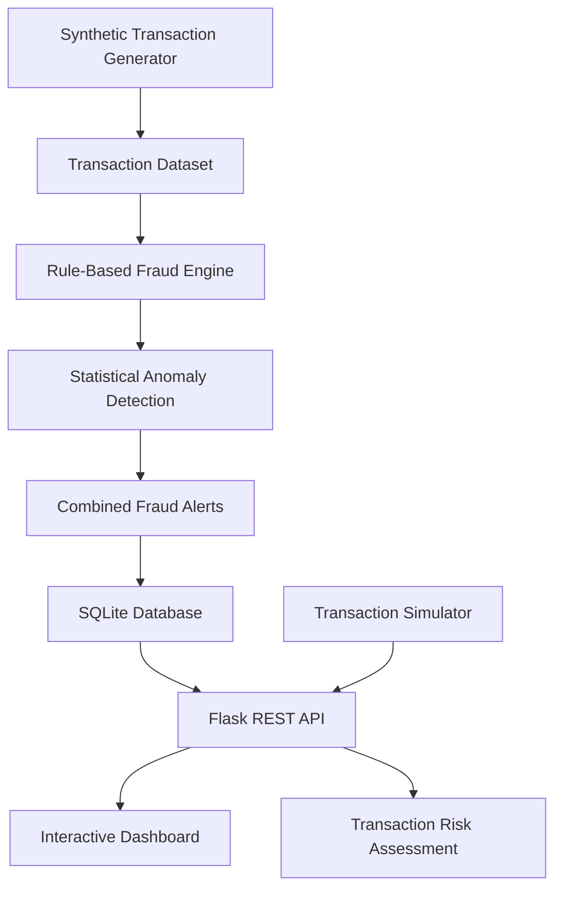
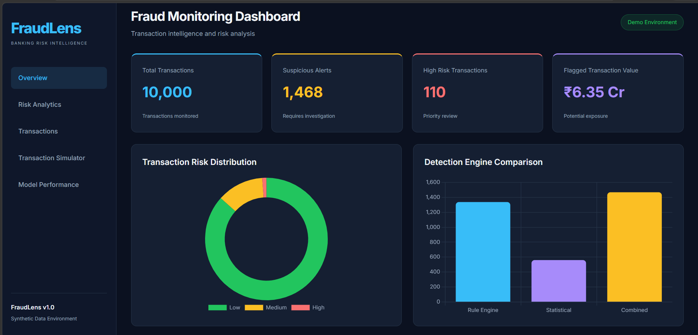
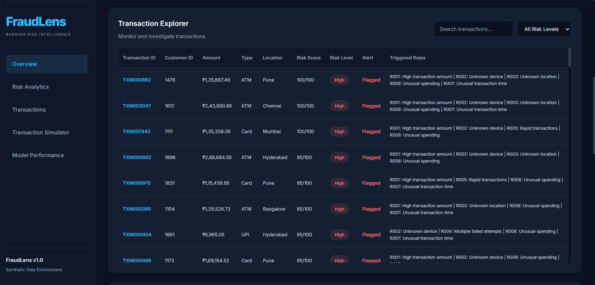
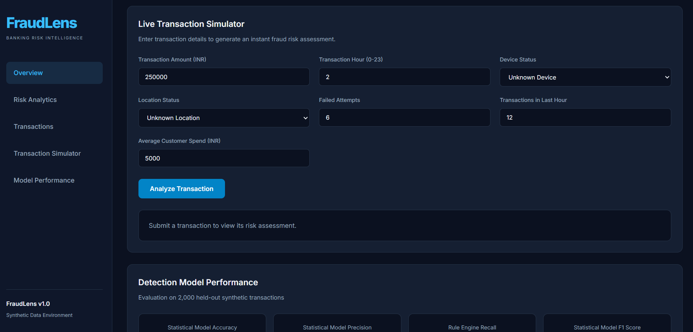
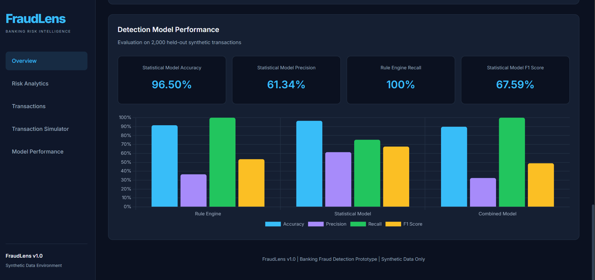

# FraudLens | Banking Fraud Detection & Risk Intelligence

FraudLens is a full-stack banking fraud detection and
transaction monitoring system that combines explainable
rule-based detection with statistical anomaly detection
to identify suspicious financial transactions.

The application simulates a banking Risk Containment
Unit (RCU) environment, enabling transaction monitoring,
risk assessment, fraud investigation and rule validation.

## Project Highlights

- 10,000 synthetic banking transactions analyzed
- 7 explainable fraud detection rules
- 1,468 transactions flagged for investigation
- 110 high-risk transactions identified
- INR 6.35 crore in flagged transaction value
- 96.50% statistical model accuracy
- 100% rule-engine recall on synthetic test data
- 26 automated tests passed
- 10 manual acceptance test scenarios passed

## Features

### Transaction Monitoring
- Interactive fraud monitoring dashboard
- Transaction risk classification
- Transaction search and risk-level filtering
- Suspicious transaction value monitoring

### Rule-Based Fraud Detection
- High transaction amount detection
- Unknown device detection
- Unknown location detection
- Multiple failed authentication attempts
- Rapid transaction frequency detection
- Unusual customer spending detection
- Unusual transaction time detection

### Statistical Anomaly Detection
- Log-transformed feature analysis
- Z-score-based anomaly detection
- Historical statistical baseline learning
- Percentile-based anomaly threshold
- Combined rule and anomaly alerts

### Live Transaction Simulator
- Real-time transaction risk assessment
- Explainable fraud detection reasons
- Risk scores between 0 and 100
- Input validation and JSON API responses

### Testing and Validation
- Automated unit testing
- API integration testing
- Boundary value analysis
- Negative input testing
- Manual User Acceptance Testing (UAT)

## Technology Stack

| Component | Technology |
|-----------|------------|
| Programming Language | Python 3.12 |
| Backend | Flask |
| Frontend | HTML, CSS, JavaScript |
| Database | SQLite |
| Data Analysis | Pandas, NumPy |
| Visualization | Chart.js |
| Anomaly Detection | Statistical Z-score Model |
| API | REST, JSON |
| Testing | Pytest |
| Version Control | Git, GitHub |

## System Architecture



## Fraud Detection Rules

| Rule ID | Detection Condition | Risk Points |
|---------|---------------------|-------------|
| R001 | Amount greater than INR 100,000 | 30 |
| R002 | Unknown device | 20 |
| R003 | Unknown location | 20 |
| R004 | Five or more failed attempts | 30 |
| R005 | Ten or more transactions in one hour | 30 |
| R006 | Amount greater than five times average spend | 25 |
| R007 | Transaction between midnight and 5 AM | 10 |

The total rule-based risk score is capped at 100.

### Risk Classification

| Risk Score | Risk Level |
|------------|------------|
| 0-29 | Low |
| 30-59 | Medium |
| 60-100 | High |

## Dataset Overview

The project uses 10,000 programmatically generated
synthetic banking transactions.

Transaction attributes include:

- Transaction ID
- Customer ID
- Transaction amount
- Transaction type
- Location
- Transaction hour
- Device recognition status
- Location recognition status
- Failed authentication attempts
- Transaction frequency
- Average customer spending
- Simulated fraud label

The dataset includes 466 simulated fraudulent
transactions and 9,534 normal transactions.

## Detection Results

| Metric | Result |
|--------|--------|
| Total Transactions | 10,000 |
| Rule-Based Alerts | 1,337 |
| Statistical Anomalies | 560 |
| Combined Alerts | 1,468 |
| Low Risk | 8,663 |
| Medium Risk | 1,227 |
| High Risk | 110 |

## Model Performance

Evaluation was performed on 2,000 held-out
synthetic transactions.

| Model | Accuracy | Precision | Recall | F1 Score |
|-------|----------|-----------|--------|----------|
| Rule Engine | 91.55% | 36.47% | 100% | 53.44% |
| Statistical Model | 96.50% | 61.34% | 75.26% | 67.59% |
| Combined Model | 89.85% | 32.33% | 100% | 48.87% |

### Key Findings

The rule engine detected all 97 simulated fraud
cases in the test set but generated more false
positives than the statistical model.

The statistical model achieved the highest
precision and F1 score.

The combined model maintained full recall but
increased the number of false alerts.

These findings demonstrate the trade-off between
fraud detection sensitivity and false-positive
reduction in transaction monitoring systems.

## API Endpoints

| Method | Endpoint | Description |
|--------|----------|-------------|
| GET | / | API status |
| GET | /dashboard | Monitoring dashboard |
| GET | /api/stats | Transaction statistics |
| GET | /api/transactions | Retrieve transactions |
| GET | /api/alerts | Retrieve suspicious alerts |
| GET | /api/risk-distribution | Risk distribution |
| POST | /api/analyze | Analyze a new transaction |

## Project Structure

```text
FraudLens/
├── data/                  # Generated at runtime
├── static/
│   ├── style.css
│   └── script.js
├── templates/
│   └── index.html
├── generate_data.py
├── fraud_engine.py
├── database.py
├── ml_model.py
├── api.py
├── app.py
├── test_fraud_engine.py
├── test_api.py
├── UAT_REPORT.md
├── requirements.txt
├── .gitignore
└── README.md
```

## Installation and Setup

### 1. Clone the repository

```bash
git clone https://github.com/rohitt1909/FraudLens.git
cd FraudLens
```

### 2. Create a virtual environment

```bash
python -m venv venv
```

Activate on Windows PowerShell:

```powershell
.\venv\Scripts\Activate.ps1
```

Activate on Linux or macOS:

```bash
source venv/bin/activate
```

### 3. Install dependencies

```bash
python -m pip install -r requirements.txt
```

### 4. Generate synthetic transactions

```bash
python generate_data.py
```

### 5. Run the fraud detection engine

```bash
python fraud_engine.py
```

### 6. Initialize the database

```bash
python database.py
```

### 7. Train the statistical anomaly model

```bash
python ml_model.py
```

### 8. Launch the application

```bash
python app.py
```

Open the dashboard in your browser:

http://127.0.0.1:5000/dashboard

An internet connection is required to load
Chart.js from its CDN.

## Automated Testing

Run all automated tests:

```bash
python -m pytest -v
```

### Test Results

| Test Category | Passed | Total |
|---------------|--------|-------|
| Unit Tests | 12 | 12 |
| API Integration Tests | 14 | 14 |
| Manual Acceptance Tests | 10 | 10 |
| Total | 36 | 36 |

Automated test execution time: 1.06 seconds
in the recorded local test run.

Detailed acceptance testing documentation
is available in [UAT_REPORT.md](UAT_REPORT.md).

## Dashboard Screenshots


### Fraud Monitoring Dashboard


### Transaction Explorer


### Live Transaction Simulator


### Model Performance



### Fraud Monitoring Dashboard


## Known Limitations

- All transactions and fraud labels are synthetic.
- Model performance does not establish real-world
  fraud detection effectiveness.
- Statistical anomaly detection is used instead
  of advanced machine learning algorithms.
- Transaction search is limited to loaded records.
- Performance metrics in the dashboard are static.
- The simulator does not persist new transactions.
- Production authentication, security and scalability
  validation are outside the current project scope.

## Future Enhancements

- Isolation Forest anomaly detection
- Supervised fraud classification models
- Real-time transaction streaming
- Configurable fraud detection rules
- Analyst investigation and case management
- Role-based access control
- Rule versioning and audit logs
- Full database search and pagination
- Automated model performance monitoring

## Author

Rohit Mishra

Final Year B.Tech Computer Engineering

GitHub: https://github.com/rohitt1909

## Disclaimer

FraudLens is an educational banking fraud detection
prototype developed using synthetic data. It is not
affiliated with any financial institution and is not
intended for production banking operations.
